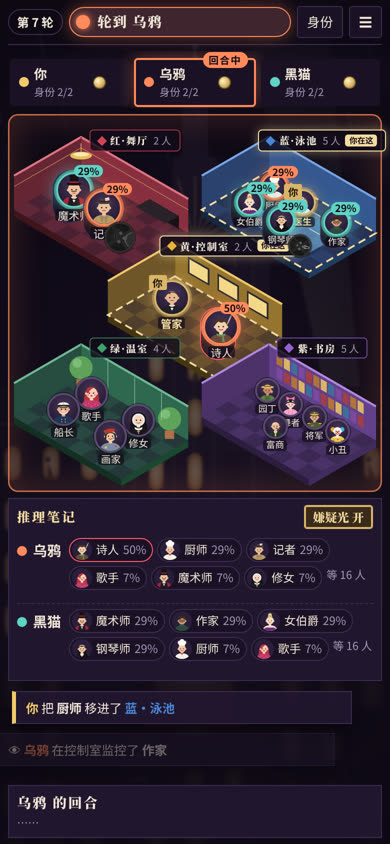

# 暗夜派对 Midnight Party

> 一九二七年，一个下雨的夜晚。二十位宾客，几张假面。你是其中一人，你的对手也藏在人群里。天亮之前，成为最后一个活着的玩家。

一款在浏览器里玩的**隐藏身份推理游戏**。可以单挑电脑 AI，也可以 2–8 人联机（空位由 AI 补上）。手机、电脑都能玩，不用下载。

**▶ 立即游玩：<https://midnight.victoraaa.tech/>**　·　首页有「三分钟看懂怎么玩」教学视频

☕ 喜欢这个游戏？可以[请作者喝杯咖啡](https://ko-fi.com/flyhust06240)。

<p align="center">
  <br>
  
  
</p>

---

## 怎么玩

### 你是谁
- 派对上有 **20 位宾客**，分散在五个房间：**红·舞厅、蓝·泳池、绿·温室、紫·书房**，以及中间的 **黄·控制室**。
- 开局时你会抽到一张宾客卡，这个人就是你。棋盘上带金圈的就是你，只有你自己看得到。
- 你的对手也各自扮成一位宾客。其余的宾客都是 NPC，活不活无所谓，他们是你的掩护。
- 人少（2–3 人）时，每人有 **两个身份**，两个都死了才出局。

### 目标
天亮之前，成为**最后一个活着的玩家**。

### 你的回合：二选一
**掷骰子**，或者花一枚代币**揭穿**一个人。

| 骰面 | 效果 |
|---|---|
| 🟥 🟦 🟩 🟪 红 / 蓝 / 绿 / 紫 | 把**任何一位**宾客移进该颜色的房间。可以移别人，也可以移自己 |
| 🟨 黄 | 把一个人移进控制室；如果你本来就在控制室，可以改为**监控**：私下查出一个人是玩家还是 NPC（但大家会知道你在控制室） |
| ⬛ 黑 | **动手**：杀掉和你同一个房间的一个人 |

- **杀人会留下线索**：倒下的人会翻牌（NPC 还是哪位玩家），而且所有人都知道凶手刚才就在这个房间。
- **制造混乱**：杀完可以从现场移走一个人。移走自己是逃跑，移走别人是转移视线，别人分不出来。
- **身边没人**：掷到黑色但房间里没有别人，你就要拉一个人进来，一样会暴露位置。

### 揭穿
- 每人只有 **1 枚**揭穿代币。
- 只能指认**和你同房间**的角色：“乌鸦，你就是钢琴师！”
- 猜对：那个身份当场出局。猜错：被你冤枉的人会看到你的真实身份。

### 午夜与天亮
- **第 20 轮午夜**：骰子的黄色面也变成杀人。
- 出局的玩家变成**幽灵**，每轮把一位宾客拖去别的房间。
- **第 50 轮天亮**，还没分出胜负就算平局。

### 推理：可能性
右侧（手机在棋盘下方）的**推理笔记**会根据公开信息，算出每个对手可能是谁。例如乌鸦在舞厅杀人时，舞厅里还站着三个人，那三人各 33%；后来乌鸦又在书房杀人，两次都在场的只有钢琴师，可能性就变成 100%。

棋盘上的**嫌疑光**把这些可能性直接亮出来：头像用对手的颜色发光，越可疑越亮，并标出百分比。点对手的名字，就只看他的嫌疑人。

---

## 特色

- **等距 3D 豪宅棋盘**：五个独立房间，各有墙、方格地板和家具；固定视角，不用转来转去，一眼看完。
- **手机一屏玩完**：顶栏、玩家条、棋盘、推理笔记、行动按钮都在同一屏，不用上下滑动。
- **回合提示清楚**：顶栏「轮到谁」标签、玩家条高亮、棋盘描边都用当前玩家的颜色；轮到你时会发金光。
- **单人对战 AI**：三档难度（新手 / 普通 / 老狐狸）。
- **联机**：房主开房间，朋友输入 4 个字母的房号加入。服务器担任裁判，每个玩家只收到自己的私密信息。
- **音乐与音效**：全部用 Web Audio 实时合成，没有音频素材文件。
- **全部简体中文界面**。

---

## 本地运行

需要 Node.js 18 以上。

```bash
npm install
npm start          # 默认端口 8080，可用环境变量 PORT 改
```

打开 <http://localhost:8080>。

---

## 部署

根目录就是一个 Node.js 服务（`npm start`），任何能跑 Node 的平台都可以部署。房间保存在服务器内存里，服务器重启后进行中的房间会消失。

**目前的线上环境**：Hostinger VPS 上的 [Coolify](https://coolify.io/)。推到 `main` 后，GitHub Actions（`.github/workflows/deploy.yml`）会通知 Coolify 重新部署。需要在仓库的 **Settings → Secrets and variables → Actions** 里设置：

| Secret | 内容 |
|---|---|
| `COOLIFY_WEBHOOK` | Coolify 应用页面 → Webhooks → Deploy Webhook 的网址 |
| `COOLIFY_TOKEN` | Coolify → Keys & Tokens 新建的 API token（需要 deploy 权限） |

也可以直接部署到 Zeabur、Render、Railway 等平台：它们会识别为 Node.js 项目，运行 `npm start`，端口由平台通过 `PORT` 提供。

---

## 开发

**改游戏只改 `src/`**，然后重新构建：

```bash
sh scripts/build.sh   # 生成 public/index.html 和 game/（不要手改这两处）
node src/sim.js       # 每种人数自动跑 1000 局，改规则后用它对比平衡数据
```

### 目录结构

| 路径 | 内容 |
|---|---|
| `server.js` | HTTP + WebSocket 服务器，担任联机裁判；`/media/` 提供教学视频（支持 Range） |
| `src/engine.js` | 规则引擎与 AI（纯逻辑，无界面） |
| `src/net.js` | 裁判流程与联机，服务器复用同一份代码 |
| `src/board.js` | 等距 3D 豪宅棋盘：房间绘制与宾客站位 |
| `src/app.js` | 界面：标题、设置、大厅、游戏主界面、弹窗、动画 |
| `src/art.js` | 20 位宾客的 SVG 头像 |
| `src/scene.js` | 背景场景：雨夜、豪宅、闪电 |
| `src/sfx.js`、`src/music.js` | 合成音效与背景音乐 |
| `src/shell.html` | 页面骨架与全部样式 |
| `public/index.html` | 构建产物：单文件游戏页面 |
| `public/media/` | 三分钟教学视频与封面 |
| `game/` | 构建产物：给服务器用的引擎副本 |
| `PLAN.md` | 原始设计文档 |

### 当前规则参数

揭穿代币 1 枚；杀人后可制造混乱；第 20 轮午夜；第 50 轮天亮平局（见 `src/engine.js` 的 `CONFIG`）。

---

## 支持作者

这个游戏免费、没有广告。如果你玩得开心，欢迎在 Ko-fi 上[请作者喝杯咖啡](https://ko-fi.com/flyhust06240) ☕，也欢迎把网址分享给朋友，一起开一局。

---

<details>
<summary>English</summary>

**Midnight Party** is a browser-based hidden-identity deduction game set at a rainy 1927 mansion party. Twenty guests, five rooms, and a few players hiding among the NPCs. On your turn, roll the die (move anyone into a coloured room, use the control room to spy, or kill someone in your room) or spend your single token to unmask a player standing in your room. Every kill leaves a clue; the deduction notebook turns those clues into probabilities and lights up suspects on the board. Be the last player alive before dawn.

Play solo against AI (three difficulty levels) or with 2–8 friends online. Works on phones and desktops, no download. Play at <https://midnight.victoraaa.tech/>. Run locally with `npm install && npm start` (Node 18+). The interface is in Simplified Chinese.

</details>
